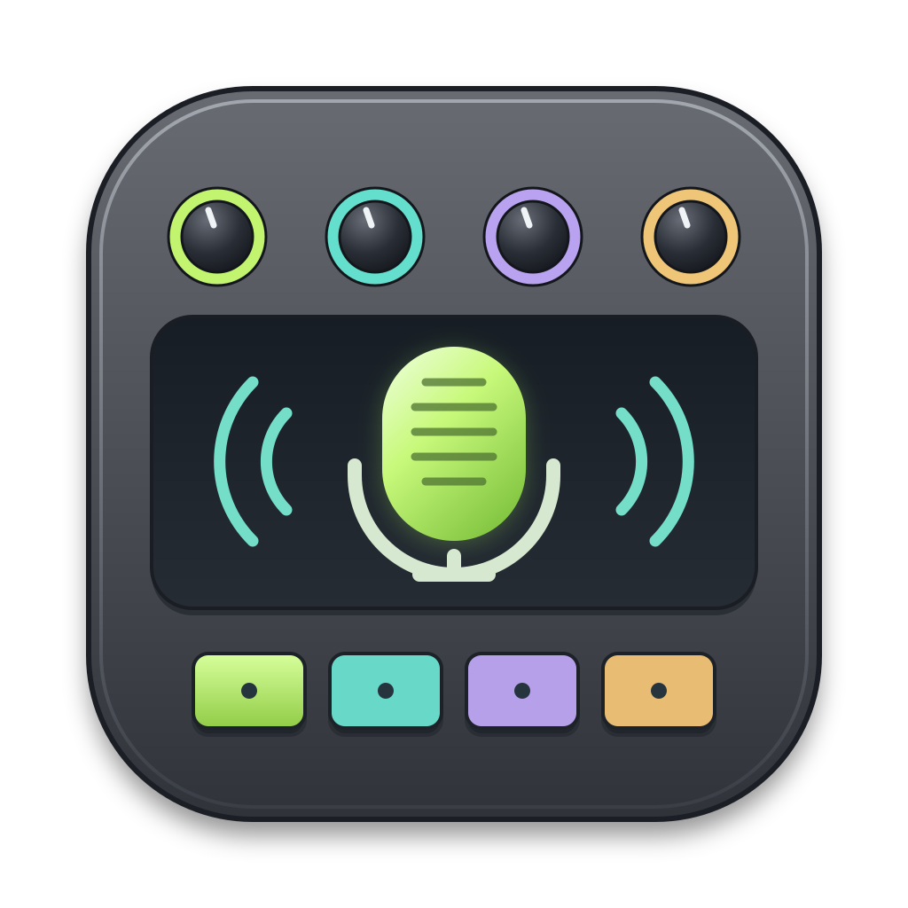
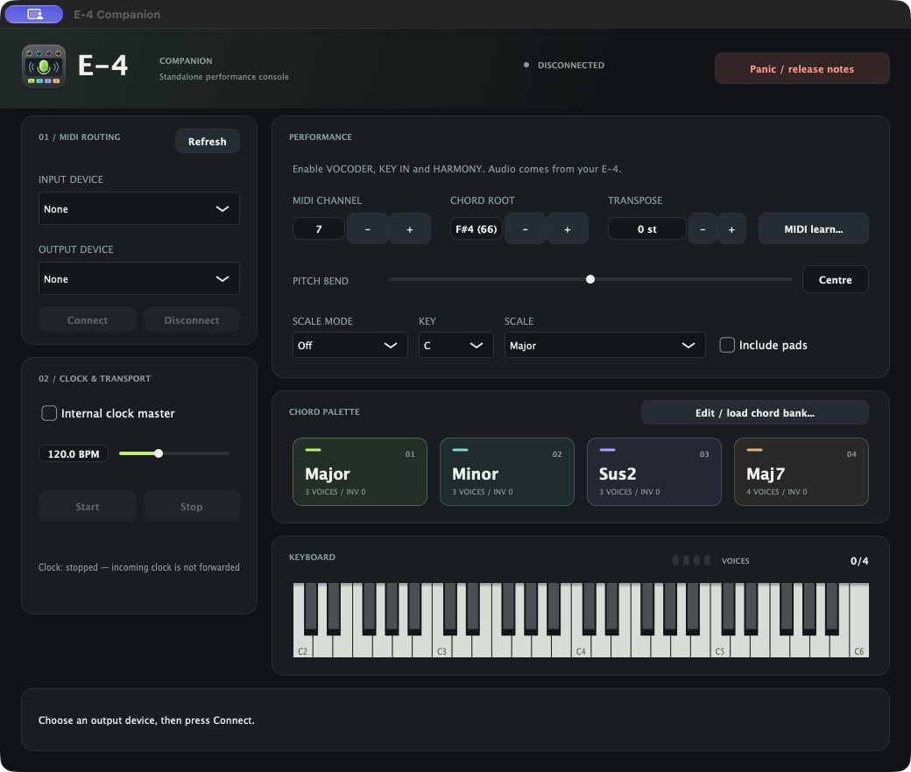
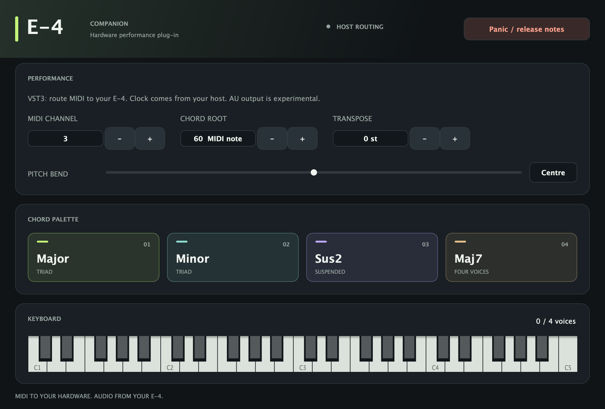
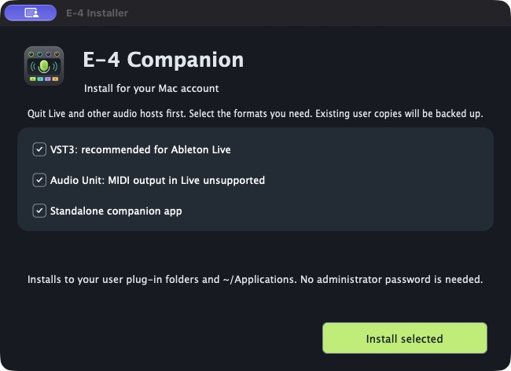
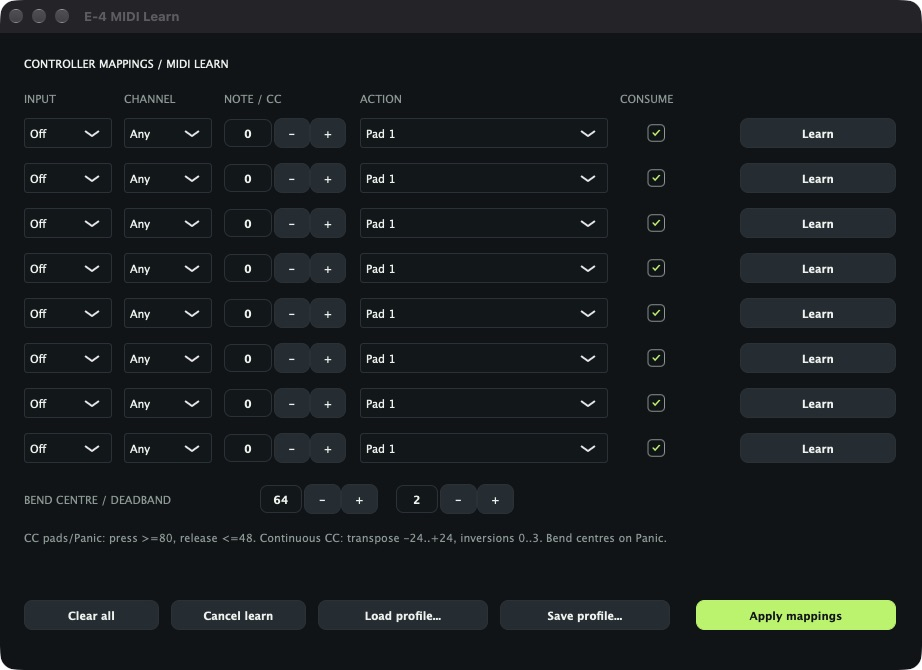
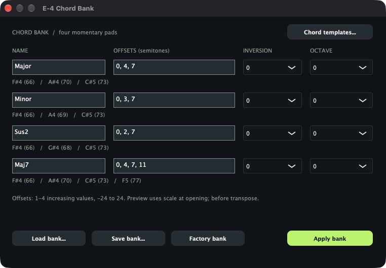

<div align="center">



# Roland AIRA Compact E-4 Companion

**Play your E-4 vocoder from a keyboard, chord pads or Ableton Live. Shape the notes on your computer; hear the voice and effects on the hardware.**

[](#getting-started)
[](#platforms-and-formats)
[](#build-from-source)
[](#licence)

[**Get started**](#getting-started) &nbsp;·&nbsp;
[**Screenshots**](#screenshots) &nbsp;·&nbsp;
[**Connect the E-4**](#connecting-the-e-4) &nbsp;·&nbsp;
[**Ableton routing**](#ableton-live) &nbsp;·&nbsp;
[**Studio test kit**](docs/studio/START-HERE.md) &nbsp;·&nbsp;
[**Build from source**](#build-from-source)

<table>
  <tr>
    <td width="50%"></td>
    <td width="50%"></td>
  </tr>
  <tr>
    <td align="center"><b>Standalone</b> — direct MIDI routing and optional internal clock</td>
    <td align="center"><b>VST3 / AU</b> — shared performance controls and saved host state</td>
  </tr>
</table>

<sub>Standalone screenshot captured from the macOS app; plug-in preview rendered from its native JUCE component. Hardware/host acceptance is recorded separately.</sub>

</div>

## Highlights

| Play | Personalise | Connect |
| --- | --- | --- |
| On-screen keyboard and incoming-note highlights | Editable four-pad chord banks and templates | Direct MIDI ports in standalone |
| Four-voice note allocation and momentary pads | Inversions, octave placement and named roots | VST3 MIDI output through Ableton Live |
| Pitch bend, transpose and Panic | Key/scale rejection or nearest-note snapping | Optional standalone MIDI clock, Start and Stop |
| Separate ownership for keyboard, screen and pad notes | Eight controller mappings, MIDI learn and reusable profiles | Settings embedded in host projects; explicit reconnect in standalone |

> [!IMPORTANT]
> This app requires the physical E-4 for sound. It produces no software audio and cannot remotely edit the hardware's reverb, formant, carrier or other knobs through the documented MIDI implementation.

## Screenshots

### Standalone and plug-in app

The screenshots at the top show the standalone MIDI console and shared VST3/AU performance interface, including the E-4 microphone logo. Routing, channel and clock settings are built into the standalone sidebar; scale, transpose and bend controls are on the main performance panel.

### Graphical installer

Choose VST3, AU and/or standalone. The installer shows the same E-4 logo and preserves existing user copies in a backup folder.



### Controller settings and MIDI learn

Eight mapping slots, channel/input choices, Consume controls, bend calibration and reusable controller profiles.



### Chord-bank settings

Edit pad names and intervals, choose inversions and octave placement, preview the resulting notes and save/load banks.



Installer, standalone and settings images are captures of the running macOS windows. They show example settings, not an instruction to change the E-4 to the pictured channel/root. The plug-in image is a native component preview. [Screenshot details](docs/ui/README.md).

## Getting started

The current **0.1.0 studio preview** has a signed, Apple-notarised **universal Mac DMG (Apple Silicon and Intel)**. It is generated locally under `build-packages/0.1.0-universal/`; it has not been published as a GitHub release. See [packaging instructions](packaging/README.md) to reproduce it. Published downloads, when available, will be on the [releases page](https://github.com/wcmCloud/Roland-Aira-Compact-E4/releases).

1. Quit Live and other audio hosts. Open the DMG and launch **E-4 Installer**.
2. Select VST3, Audio Unit and/or standalone. The graphical installer uses your user plug-in folders and `~/Applications`, preserving earlier copies in `~/Library/Application Support/E-4 Companion/Installer Backups`.
3. Restart/rescan your host. **Use VST3 in Ableton Live.** AU MIDI output in Live remains unsupported.
4. Copy **Studio Test Kit** out of the DMG into a writable folder. It contains a saved Live set, three short MIDI clips, a controller profile, diagnostics, setup instructions and a result sheet.
5. Follow [Connecting the E-4](#connecting-the-e-4), then the [studio checklist](docs/studio/START-HERE.md).

The DMG is the finished studio installation path. The separate system-wide `.pkg` remains an unsigned development artifact until a **Developer ID Installer** certificate is available; the graphical DMG installer already uses the available Developer ID Application certificate and notarisation workflow.

## Platforms and formats

| Platform / format | Current status |
| --- | --- |
| macOS Apple Silicon standalone | Built, signed/notarised and installation-tested |
| macOS Apple Silicon VST3 | Formal validation passed; Live routing/recall smoke tests passed |
| macOS Apple Silicon AU | Apple AU validation passed; MIDI-output workflow remains experimental |
| Intel Mac / universal | Universal DMG signed/notarised; native Intel CI tests passed; studio acceptance pending |
| Windows / Linux VST3 and standalone | Native x64/ARM64 CI tests and packaging passed; studio acceptance pending |

The sources use JUCE/C++17 and select AU only on Apple platforms. Cross-platform source does not mean one installer works on every operating system. The current build declares macOS 11 minimum; running on that oldest version has not been verified.

## Connecting the E-4

Connect USB MIDI, choose the E-4 output and match its MIDI channel (factory default **3**). On the hardware enable **VOCODER**, **KEY IN** and **HARMONY** for four voices. These settings are manual; the app cannot read or switch them.

- **Standalone:** select the E-4 MIDI output and an optional controller input, then press **Connect**. Changed port selections take effect only when applied. Settings persist, but outputs never auto-connect and held notes never replay on restore. Check remembered channel/root settings before playing.
- **Listen:** connect headphones/speakers directly to the E-4, or route its audio to your studio interface/DAW. The companion opens no standalone audio device. E-4 USB audio return was unreliable on the development Mac and remains a studio check; analog audio into an interface is another route to test.
- **Recover:** Panic sends explicit releases for owned notes and centres bend. Missing devices, host suspension or removal can prevent final MIDI delivery; see [hardware checks](docs/HARDWARE_TESTS.md).

The baseline is the E-4 **v1.02** MIDI chart: notes 0–127, up to four vocoder voices, pitch bend, timing clock, Start and Stop. It has no documented CC, SysEx or program-change parameter control. Controller CCs are interpreted locally by this app and filtered from E-4 output. No hardware preset backup/restore is offered.

## Ableton Live

1. **E4 Controller:** load the VST3 on a MIDI track. Choose your keyboard input and **Monitor In** for live playing.
2. **E4 Send:** another MIDI track, MIDI From **E4 Controller**, lower chooser **E-4 Companion**, Monitor **In**. MIDI To **E-4 (MIDI IN)**, channel **3** or the hardware's configured channel.
3. **E4 Audio Return:** select the physical E-4/interface audio input before enabling monitoring or recording. Add reverb or other audio effects here.

For MIDI **clip playback**, set Controller Monitor **Auto**, leave it unarmed, and keep Send Monitor In; Controller Monitor In can suppress clips. Audio device preferences are machine-specific and are not carried by the saved set. Keep standalone disconnected when Live uses the same E-4 output.

The [saved studio set and routing guide](docs/ableton/README.md) were prepared in **Live 12.4.7 Lite**. Use the recipe above if an older version cannot open the set. Plug-in clock is delegated to Live's port **Sync**; do not run a second clock master alongside it.

## Performance controls

- **Keyboard:** incoming highlights show original input pitches before scale/transpose without generating extra MIDI. Labels use **C4 = MIDI 60**; Live's octave naming may differ.
- **Chord pads:** edit names/intervals, use templates, choose inversions and octave placement, preview notes and save/load `.e4bank` files. Loading stages edits; **Apply bank** activates them. Pads are momentary and share the four-voice budget.
- **Scales:** Off, Reject or Nearest; twelve tonics with Major, Natural minor, Major pentatonic, Minor pentatonic or Chromatic. Scale runs before global transpose; nearest ties choose the lower note. Pad inclusion is optional.
- **Transpose/bend:** transpose ±24 semitones; out-of-range notes are rejected. Bend springs to centre; the E-4 determines its audible range.
- **MIDI learn:** eight slots for notes/CCs, any or specific channels, consumed or passed-through note triggers, pads, transpose, inversions, bend and Panic. Learning captures without triggering; release and use a fresh gesture after Apply. `.e4map` imports stage edits before Apply.
- **State:** the plug-in embeds banks, mappings and settings in the host project. Standalone remembers applied settings on normal exit, starts disconnected and leaves clock off.

### Standalone clock

Enable **Internal clock master**, choose 20–300 BPM and press Start. Clock uses 24 pulses per quarter note; Stop/Panic stops transport, releases owned notes and centres bend. Use one master only. No incoming-clock follow, Continue or song-position chase is implemented. Actual looper arming/response and timing under load need hardware verification.

Arpeggiator, sequencer and latch remain deferred by choice. Audio effects and recording belong in the DAW.

## Validation and studio tests

The [release preflight record](docs/validation/studio-preflight-2026-10-24/README.md) includes:

- Apple `auval` passed; official Steinberg validator **47 passed, zero failed**.
- All **eight** project test checks and **31** installed VST3 wrapper checks passed.
- Live scan/load, parameter editing and saved transpose recall, multiple-instance load/remove and idle transport/activation smoke tests.
- Six notes and six matching releases captured from Live on channel 3, including 64/256/1024-sample buffer checks. Bend capture covered centre resets only.
- Graphical fresh installation, upgrade/backups, forced-failure rollback, final payload integrity, notarisation/stapling and Gatekeeper checks.

Four-note hardware playback was confirmed by the user. Audible bend, physical-controller learn/CC delivery, held-note cleanup, clock/looper behaviour, hotplug/sleep, USB audio return and an actual clean-account/machine install remain open. A format validator is not a substitute for those tests. Use the [studio checklist](docs/studio/START-HERE.md) and [result sheet](docs/studio/RESULTS.md).

## Cross-platform builds and releases

[Native build results](https://github.com/wcmCloud/Roland-Aira-Compact-E4/actions/workflows/release.yml) cover macOS Apple Silicon/Intel, Windows x64/ARM64 and Linux x64/ARM64. A successful build verifies compilation and automated MIDI/processor/VST3 tests; physical hardware and DAW acceptance remain separate checks. AU is macOS-only. Choose the architecture matching your DAW.

The workflow packages native standalone and VST3 builds with licence notices and corresponding JUCE sources. Windows ZIPs include an optional per-user `install.ps1`; Linux archives include `install.sh`. Windows builds are unsigned previews. CI macOS ZIPs are unsigned development builds; use the locally signed and notarised DMG for normal Mac installation. Linux currently targets Ubuntu 24.04 or a compatible system with the documented build dependencies.

To prepare a release, update the version in `CMakeLists.txt`, commit, and push the matching `vX.Y.Z` tag. All six builds must pass before GitHub creates a draft prerelease. Add the locally signed/notarised Mac DMG and its checksum, review the release assets and notes, then publish. Apple signing credentials stay in the local Keychain. See [release notes](docs/RELEASE-NOTES.md) for installation and remaining studio checks.

## Build from source

Requires CMake 3.22+, a C++17 compiler and JUCE **8.0.10**. On macOS use Xcode/command-line tools. Generated icon assets are committed; .NET is needed only to regenerate artwork.

```sh
cmake -S . -B build-check -DCMAKE_BUILD_TYPE=Debug -DJUCE_SOURCE_DIR="/absolute/path/to/JUCE"
cmake --build build-check --target AiraE4_VST3 AiraE4_AU AiraE4_Standalone e4_core_tests e4_clock_tests e4_mapping_tests e4_output_tests e4_processor_tests e4_vst3_check e4_midi_probe -j 6
ctest --test-dir build-check --output-on-failure
```

On non-Apple platforms omit `AiraE4_AU`; native CI tests those builds, while DAW/hardware acceptance remains pending. `-DE4_FETCH_JUCE=ON` can fetch the pinned JUCE version instead of `JUCE_SOURCE_DIR`. For Xcode generation, add `-G Xcode`, omit `CMAKE_BUILD_TYPE` and use `--config Debug` / `ctest -C Debug`. The verified automated builds here used Makefiles.

```sh
./scripts/run-debug.sh              # Build and open the Debug standalone
./scripts/run-debug.sh --debug      # Run under LLDB
./scripts/run-debug.sh --build-only # Build without launching
```

[Packaging/signing/notarisation](packaging/README.md) · [Architecture and real-time limits](docs/architecture/PERFORMANCE.md) · [Implementation roadmap](PLAN.md) · [Receive-only diagnostics](docs/studio/DIAGNOSTICS.md) · [Icon sources](assets/icon/README.md)

## Contributing and issues

Report the operating system and host version, E-4 firmware, MIDI/audio route, sample rate/buffer and exact reproduction steps. Say whether the issue occurs in standalone, Live or another host; attach a short MIDI/audio capture when relevant. Keep software simulations, host observations and physical hardware results separate. Contributions are accepted under the project licence choice below.

## Licence

Copyright © 2026 Christos Christodoulidis.

Project-authored code, documentation and original icon assets are **dual-licensed**, at your choice, under:

- the [MIT License](LICENSE-MIT), or
- the [GNU General Public License v3.0](LICENSE-GPL-3.0) (**GPL-3.0-only**).

SPDX: **`MIT OR GPL-3.0-only`**. Contributions use the same terms, matching the [T-8 project](https://github.com/wcmCloud/Roland-Aira-Compact-T8).

**Dependency terms still apply.** JUCE 8 framework modules are AGPLv3/commercial, so linked apps/plug-ins are not MIT-only binaries. See [project licensing](LICENSE.md) and [third-party notices](THIRD_PARTY_NOTICES.md), including corresponding-source and distribution requirements. The studio package includes licence texts and build sources with the pinned JUCE source.

Roland, AIRA and E-4 are trademarks of Roland Corporation. This is an independent project, not made or endorsed by Roland. The owner's manual in `docs` is Roland's material, is excluded from these licences and is not included in the studio installer/source archive.
